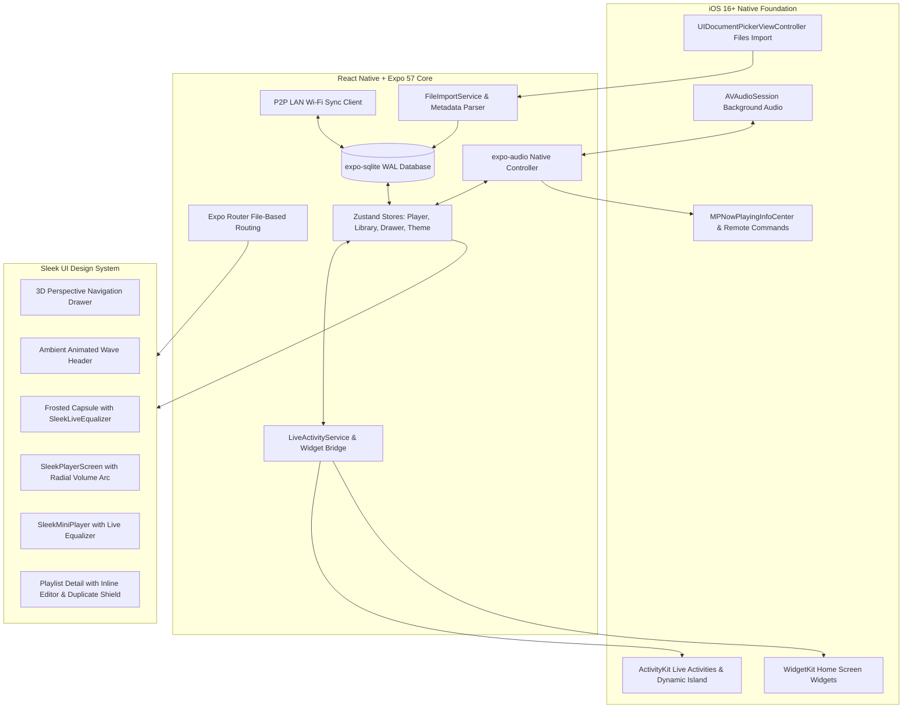

# 📱 Overtone iOS Companion App — Specification, UI/UX & Architecture Guide

> **Milestone:** v1.0.0 — Sleek UI Edition  
> **Platform:** iOS 16.0+ (iPhone)  
> **Runtime:** React Native 0.86, Expo SDK 57 (Hermes Engine)  
> **Design Language:** Sleek UI / Night Star Aesthetic  
> **Sync Protocol:** 100% Cloud-Free Local Wi-Fi P2P Pairing with Desktop Overtone  

---

## 🌟 Executive Overview

The **Overtone iOS Companion App** is an offline-first, native iOS music player designed to deliver the luxury ergonomics and visual polish of modern streaming apps without cloud lock-in, subscriptions, or telemetry. It functions both as an autonomous, on-device local music player and as a local-network companion to the [Overtone Desktop Electron App](file:///d:/Desktop/overtune).

Key highlights:
- **Zero Cloud Footprint:** No accounts, no servers, no trackers. Your music and metadata remain 100% on your device.
- **Sleek UI Design Language:** Custom-crafted Night Star dark theme with animated flowing amber waves, 3D perspective drawer navigation, vinyl disc player with tactile radial volume arc, and live animated equalizers.
- **Deep iOS Integration:** Background audio playback, Lock Screen media controls, Dynamic Island and Live Activities (`ActivityKit`), and interactive Home Screen Widgets (`WidgetKit`).
- **Local Wi-Fi Cross-Sync:** Pair with desktop Overtone over LAN using secure 6-digit PINs to preview and sync playlists without uploading audio to external servers.
- **High-Performance Database:** Embedded SQLite database in WAL mode with transactional schema migrations.

---

## 🏗️ System Architecture



---

## 🎨 Sleek UI/UX Design System

The mobile interface is designed under the **Sleek UI** philosophy — prioritizing tactile feedback, fluid physics, and high contrast against an atmospheric midnight backdrop:

### 1. Night Star Color Palette
| Token | Hex Value | Role |
|---|---|---|
| `bg` | `#0a0b10` | Deep midnight canvas background |
| `surface` | `#12131c` | Elevated card and container background |
| `surfaceHighlight` | `#1c1e2d` | Active track row and hover state highlight |
| `accent` | `#f59e0b` | Energetic golden amber primary accent |
| `accentGlow` | `rgba(245, 158, 11, 0.25)` | Ambient glow behind artwork and equalizer |
| `textPrimary` | `#ffffff` | High-contrast heading and active title text |
| `textSecondary` | `rgba(255, 255, 255, 0.65)` | Subtitles, artist names, and durations |
| `border` | `rgba(255, 255, 255, 0.08)` | Subtle border dividers |

### 2. 3D Perspective Drawer Navigation
- **Gesture-Driven:** Swipe right anywhere on the home canvas or tap the menu hamburger to trigger the navigation drawer.
- **3D Spatial Transform:** The active screen smoothly scales to `0.88`, rotates on the Y-axis by `-15deg`, rounds its corners to `36px`, and offsets horizontally by `280px` with spring-physics damping (`damping: 18, stiffness: 120`).
- **Destinations:** Instant access to Home, Discover, Playlists, Library, Search, Wi-Fi Sync, and Settings.

### 3. Ambient Flowing Amber Wave Header
- **Wave Dynamics:** The top section features continuous organic amber wave contours (`#f59e0b` / `#d97706`) animated with sinus rhythm micro-fluctuations.
- **Personalized Header:** Displays a welcoming "Welcome back" greeting, listener profile avatar, and instant quick-search bar.

### 4. Frosted Now Playing Capsule with Live Equalizer
- **Vertical & Horizontal Centering:** Positioned in the header section above the main feed.
- **Live Multi-Bar Equalizer (`SleekLiveEqualizer`):** Five animated frequency bars simulating live spectrum analysis during playback, smoothly transitioning to static resting heights when paused.

### 5. Fullscreen Sleek Player Screen
- **Circular Radial Volume Arc:** Replaces clumsy linear volume sliders with an elegant circular arc enclosing the spinning album artwork. Rotating your finger around the arc smoothly adjusts output volume with subtle iOS haptic ticks.
- **Turntable Vinyl Disc:** The album artwork is housed inside a turntable vinyl record featuring concentric physical grooving and authentic rotational momentum during active playback.
- **Touch-Scrubbable Waveform Seekbar:** Direct seeking across the track duration with time markers and elapsed duration readout.
- **Playback Speed Controller:** Quick cycle between `0.5x`, `0.75x`, `1.0x`, `1.25x`, `1.5x`, and `2.0x` speeds.
- **Lyric Timing Offset:** Real-time 100ms offset stepper persisted into the local SQLite database.

### 6. Dynamic MiniPlayer Card
- **Floating Dock:** Hovering above the bottom navigation bar with translucent blur backdrop.
- **Animated Audio Icon:** Static musical note icon is replaced with live animated equalizer bars whenever audio is playing, offering immediate feedback across the entire app.
- **Expanding Gesture:** Tap to expand into Fullscreen Sleek Player or swipe to skip tracks.

### 7. Playlist Duplicate Warning Modal
- **Intelligent Pre-Add Validation:** When adding a track to a playlist, Overtone checks if the song is already present in `playlist_tracks`.
- **Informative Dialog:** Displays track cover art, song title, artist, and destination playlist name with an "Already in Playlist" warning, preventing accidental duplicate entries.

### 8. Inline Playlist Detail Editor
- **Pencil Edit Action:** Located at the top right of the single playlist screen.
- **In-Place Metadata Editing:** Edit playlist title and description without navigating away.
- **Track Management:** Single-swipe quick track removal and bulk removal mode.

---

## 🍏 Native iOS System Integrations

### 1. Background Audio Playback
Configured via `AVAudioSession`:
```swift
try AVAudioSession.sharedInstance().setCategory(
    .playback,
    mode: .default,
    options: [.allowAirPlay, .allowBluetooth]
)
try AVAudioSession.sharedInstance().setActive(true)
```
- Continuous playback when the app is backgrounded or device is locked.
- Graceful handling of audio interruptions (phone calls, alarms, Siri) with automatic resume on interruption end.

### 2. Live Activities & Dynamic Island
Implemented in native Swift (`mobile/targets/widgets/OvertoneLiveActivity.swift`):
- **Dynamic Island Compact Leading:** Miniature rounded album artwork.
- **Dynamic Island Compact Trailing:** Real-time animated audio soundwave indicator.
- **Dynamic Island Expanded:** Complete track title, artist name, interactive Play/Pause/Skip buttons, and live duration progress bar.
- **Lock Screen Live Activity:** Full-width ambient card with high-resolution artwork, progress timeline, and media controls.

### 3. Lock Screen & Control Center Media Controls
Integrated with `MPNowPlayingInfoCenter` and `MPRemoteCommandCenter`:
- Displays track title, artist name, album name, and high-resolution cover artwork.
- Supports system media keys: Play, Pause, Next Track, Previous Track, and Seek timeline scrubbing.

### 4. Interactive Home Screen Widgets (`WidgetKit`)
Implemented in Swift (`mobile/targets/widgets/OvertoneNowPlayingWidget.swift`):
- **Supported Sizes:** Small, Medium, Large.
- **Shared Storage:** Synchronized via iOS App Groups (`group.com.overtone.music`) and `SharedPlaybackData.swift`.
- Shows active track artwork, title, artist, and playback status directly on the user's iPhone Home Screen.

### 5. 100% Cloud-Free Local Wi-Fi Cross-Sync
- **LAN Pairing:** Connects directly to the desktop Electron app over the local Wi-Fi network (default port `47848`).
- **Security:** 6-digit numeric PIN pairing with time-limited expiration.
- **Track Matching (`matching.ts`):** Compares playlist track titles and artists against local files using fuzzy string distance algorithms.
- **Sidecar Preview:** Users can inspect incoming playlists, match percentage, and preview missing tracks before committing imports.

### 6. Local-First SQLite Database (`expo-sqlite`)
Schema mirrors desktop database logic:
- `tracks`: File paths, title, artist, album, duration, artwork URI, rating, tags, play counts.
- `artists`: Name, track counts, album counts.
- `albums`: Title, artist, artwork URI, release year.
- `playlists`: Name, description, artwork URI, created timestamp.
- `playlist_tracks`: Relational mapping of playlists to tracks with strict ordering.
- `favorites`: Liked tracks index.
- `schema_migrations`: Versioned migration logs for future updates.

---

## 📂 Mobile Codebase Structure

```
mobile/
├── app/                                # Expo Router file-based screens
│   ├── (tabs)/                         # Bottom tabs layout
│   │   ├── _layout.tsx                 # Tab navigator definition
│   │   ├── index.tsx                   # Sleek Home screen
│   │   ├── library.tsx                 # Songs, Albums, Artists directory
│   │   ├── search.tsx                  # Instant local library search
│   │   ├── listen.tsx                  # Personal mixes & discovery
│   │   └── settings.tsx                # Settings, themes & Wi-Fi sync status
│   ├── album/[id].tsx                  # Album detail screen
│   ├── artist/[id].tsx                 # Artist detail screen
│   ├── playlist/[id].tsx               # Single playlist screen with inline editing & duplicate warnings
│   ├── sync/
│   │   ├── pair.tsx                    # Wi-Fi PIN pairing screen
│   │   └── preview.tsx                 # Incoming playlist preview & conflict review
│   ├── now-playing.tsx                 # Fullscreen Sleek player route
│   └── _layout.tsx                     # Root application provider shell
│
├── src/
│   ├── components/sleek/               # Sleek UI Design System Components
│   │   ├── SleekAppShell.tsx           # Master layout orchestrating 3D drawer & navigation
│   │   ├── SleekDrawer.tsx             # 3D perspective slide-in drawer
│   │   ├── SleekDrawerLayout.tsx       # Gesture handler & spring animation layout
│   │   ├── SleekHeader.tsx             # Amber wave header with avatar & search
│   │   ├── SleekHomeScreen.tsx         # Night Star home dashboard with mixes & pills
│   │   ├── SleekPlayerScreen.tsx       # Fullscreen player with vinyl disc & radial volume arc
│   │   ├── SleekMiniPlayer.tsx         # Docked miniplayer with live equalizer bars
│   │   ├── SleekLiveEqualizer.tsx      # Multi-bar animated audio equalizer visualizer
│   │   ├── SleekTrackRow.tsx           # Track item with dynamic playing equalizer indicator
│   │   ├── SleekPlaylistCard.tsx       # Visual playlist card with quick edit pencil
│   │   └── SleekTrackActionSheet.tsx   # Bottom sheet for track actions & playlist add
│   │
│   ├── db/                             # SQLite Database Layer
│   │   ├── migrations/
│   │   │   └── 001_initial.ts          # Baseline SQLite schema migration
│   │   └── repositories/
│   │       └── index.ts                # Repositories for tracks, playlists, and favorites
│   │
│   ├── services/                       # Platform Services
│   │   ├── audio/AudioService.ts       # expo-audio controller & background audio
│   │   ├── backup/BackupService.ts     # overtone-backup v1.0 JSON export/import
│   │   ├── files/FileImportService.ts  # Document picker & local file caching
│   │   ├── lyrics/LyricsService.ts     # LRC/TXT synchronized lyrics parser
│   │   ├── metadata/MetadataExtractor.ts # music-metadata ID3 tag parser
│   │   ├── sync/SyncService.ts         # Local Wi-Fi cross-sync HTTP client
│   │   └── widgets/
│   │       ├── LiveActivityService.ts  # ActivityKit dynamic island updater
│   │       ├── WidgetService.ts        # App Group shared data bridge
│   │       └── index.ts                # Widget services aggregator
│   │
│   ├── store/                          # Zustand State Management
│   │   ├── usePlayerStore.ts           # Central playback & queue state
│   │   ├── useLibraryStore.ts          # SQLite library cache & query state
│   │   ├── useDrawerStore.ts           # 3D drawer open/close animation state
│   │   ├── useThemeStore.ts            # Active theme & accent state
│   │   └── useUserStore.ts             # User profile, avatar & preferences
│   │
│   └── design/                         # Design Tokens & Constants
│       ├── colors.ts                   # Night Star color palette
│       ├── typography.ts               # Font scales & line heights
│       ├── spacing.ts                  # Grid spacing tokens
│       └── motion.ts                   # Spring physics animation configs
│
├── targets/widgets/                    # Native iOS Extension Targets (Swift)
│   ├── Info.plist                      # Widget extension permissions
│   ├── MusicActivityAttributes.swift   # ActivityKit data schema
│   ├── OvertoneLiveActivity.swift      # Dynamic Island & Lock Screen Live Activity
│   ├── OvertoneNowPlayingWidget.swift  # Home Screen Small/Medium/Large widgets
│   ├── OvertoneWidgetBundle.swift      # Main widget bundle export
│   └── SharedPlaybackData.swift        # App Group shared memory models
│
├── plugins/
│   └── withWidgets.js                  # Custom Expo config plugin for Xcode widget target
│
└── __tests__/                          # Comprehensive Automated Test Suites
    ├── sleek_player.test.ts            # Player controls, radial volume arc & vinyl rotation
    ├── sleek_sidebar.test.ts           # 3D drawer transitions & route selection
    ├── playlist_duplicates.test.ts     # Duplicate detection & warning modals
    ├── matching.test.ts                # Track title/artist fuzzy matching engine
    ├── widget_service.test.ts          # App Group shared memory & Live Activity payloads
    ├── lyrics_service.test.ts          # LRC parsing & synchronized line seeking
    └── backup_service.test.ts          # Backup JSON serialization & schema validation
```

---

## 🧪 Automated Testing & Quality Gates

The iOS app maintains a **100% passing test suite (43/43 tests)** executed via Jest:

```bash
cd mobile
npm test
```

```
PASS  __tests__/sleek_player.test.ts
PASS  __tests__/sleek_sidebar.test.ts
PASS  __tests__/playlist_duplicates.test.ts
PASS  __tests__/matching.test.ts
PASS  __tests__/widget_service.test.ts
PASS  __tests__/lyrics_service.test.ts
PASS  __tests__/backup_service.test.ts

Test Suites: 7 passed, 7 total
Tests:       43 passed, 43 total
Snapshots:   0 total
Time:        3.42 s
```

### Static Analysis & Bundling Verification
```bash
# TypeScript verification (0 errors)
npm run typecheck

# ESLint analysis (0 warnings)
npm run lint

# Native iOS Hermes bundle export (0 errors)
npx expo export --platform ios
```

---

## 🚢 Building & Deployment

### Local Development
```bash
cd mobile
npx expo start -c
```
- Press `i` to launch in iOS Simulator.
- Scan QR code to launch on a physical iPhone via Expo Go or Development Build.

### Cloud Native Builds (EAS Build)
Configured in `mobile/eas.json`:
- **Development Build:** `eas build --profile development --platform ios`
- **Internal Preview:** `eas build --profile preview --platform ios`
- **App Store Production:** `eas build --profile production --platform ios`
